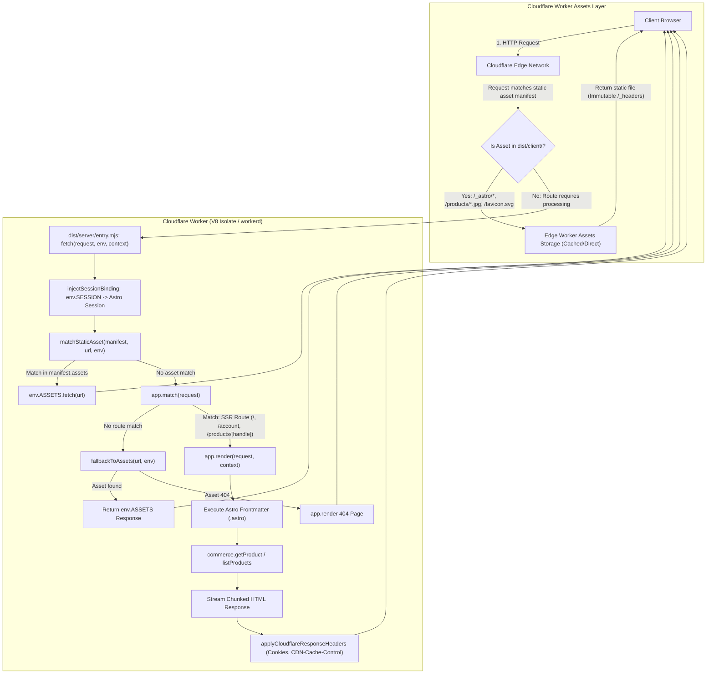
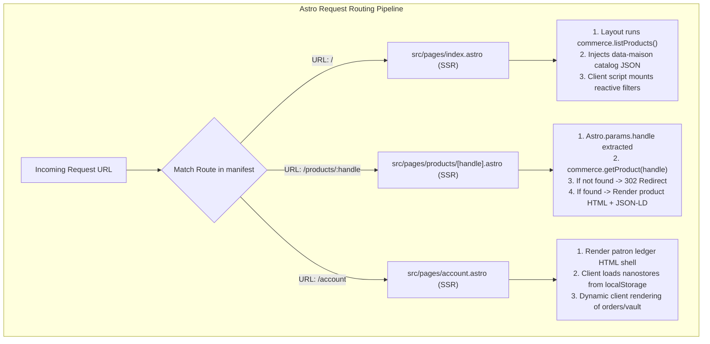

# Astro on Cloudflare Workers Architecture Guide

This document details the architectural and runtime mechanics of the Astro storefront running as a Cloudflare Worker Server-Side Rendered (SSR) application in `astro-njx-maison`.

---

## 1. High-Level System Architecture

The following diagram illustrates how incoming HTTP requests flow through Cloudflare's edge network, Cloudflare Worker Assets, the V8 isolate running Astro SSR, and back to the client:



---

## 2. Astro Framework on Cloudflare Workers

### 2.1 Adapter Mechanics: `@astrojs/cloudflare` in `workerd`
Cloudflare Workers execute inside **V8 isolates** powered by Cloudflare's open-source runtime, **`workerd`**. Unlike Node.js server environments:
- There is no long-running OS process or persistent file system.
- Native C/C++ Node.js addons (such as `sharp` / `libvips`) cannot be executed.
- Server execution is ephemeral, request-driven, and memory-constrained.

To bridge Astro with `workerd`, Astro uses the `@astrojs/cloudflare` adapter configured in [`astro.config.mjs`](file:///root/project/demo-web-builder/astro-njx-maison/astro.config.mjs#L1-L18):

```javascript
// astro.config.mjs (lines 7-16)
export default defineConfig({
  output: 'server',
  adapter: cloudflare({
    imageService: 'passthrough',
  }),
  site: 'https://astro-njx-maison.pages.dev',
  vite: {
    plugins: [tailwindcss()],
  },
});
```

During build, `@astrojs/cloudflare`:
1. Integrates the Cloudflare Vite plugin (`@cloudflare/vite-plugin`) into Vite's SSR environment (`viteEnvironment: { name: "ssr" }`).
2. Configures resolution for `cloudflare:*` virtual modules (e.g. `import { env } from "cloudflare:workers"`).
3. Defines external dependencies and bundles the server code into a self-contained ES module output for Cloudflare Workers.
4. Generates a deployment configuration file [`dist/server/wrangler.json`](file:///root/project/demo-web-builder/astro-njx-maison/dist/server/wrangler.json#L1).

---

### 2.2 Server Entry Point and Request Pipeline

The server bundle entry point is located at [`dist/server/entry.mjs`](file:///root/project/demo-web-builder/astro-njx-maison/dist/server/entry.mjs#L1-L132). It exports the standard Cloudflare Worker ES module fetch handler:

```javascript
// dist/server/entry.mjs (lines 128-131)
var worker_entry_default = { fetch: handle };
export { worker_entry_default as default };
```

#### The Request Execution Pipeline (`handle`)
When a request enters the worker via `handle(request, env, context)` in [`dist/server/entry.mjs`](file:///root/project/demo-web-builder/astro-njx-maison/dist/server/entry.mjs#L102-L126):

```javascript
// dist/server/entry.mjs (lines 102-126)
var app = createApp();
async function handle(request, env, context) {
	injectSessionBinding(app.manifest, env);
	const staticAsset = matchStaticAsset(app.manifest, request.url, env);
	if (staticAsset) return staticAsset;
	let routeData = void 0;
	if (app.isDev()) {
		const result = await app.devMatch(app.getPathnameFromRequest(request));
		if (result) routeData = result.routeData;
	} else routeData = app.match(request);
	if (!routeData) {
		const asset = await fallbackToAssets(request.url, env);
		if (asset) return asset;
	}
	const locals = createLocals(context);
	const waitUntil = context.waitUntil.bind(context);
	const response = await app.render(request, {
		routeData,
		locals,
		waitUntil,
		prerenderedErrorPageFetch: createErrorPageFetch(env),
		clientAddress: getClientAddress(request)
	});
	return applyCloudflareResponseHeaders(response, app.setCookieHeaders ? [...app.setCookieHeaders(response)] : [], false);
}
```

The sequence unfolds as follows:
1. **Binding Injection (`injectSessionBinding`)**: Lines 77–82 inject the `env.SESSION` KV namespace into Astro's session manifest (`manifest.sessionConfig.options.binding = env[sessionKVBindingName]`).
2. **Asset Pre-check (`matchStaticAsset`)**: Lines 38–41 check `manifest.assets.has(pathname)`. If the request targets a known client asset, the worker immediately delegates to `env.ASSETS.fetch(requestUrl)` without running Astro's component pipeline.
3. **Route Matching (`app.match`)**: Line 111 matches the URL against compiled route regex patterns stored in `app.manifest.routes` in [`dist/server/chunks/entrypoints_C7rdWwXW.mjs`](file:///root/project/demo-web-builder/astro-njx-maison/dist/server/chunks/entrypoints_C7rdWwXW.mjs#L140-L180).
4. **Asset Fallback (`fallbackToAssets`)**: Lines 42–45 check `env.ASSETS` for extensionless static files if no route is matched before proceeding to 404 rendering.
5. **Execution Context (`createLocals` & `waitUntil`)**: Lines 51–71 expose `cfContext: context` on `locals` and bind Cloudflare's background task handler `context.waitUntil(...)`. `getClientAddress` extracts the real client IP from `cf-connecting-ip`.
6. **SSR Rendering (`app.render`)**: Renders the matched `.astro` page component, streaming rendered HTML chunks.
7. **Response Header Finalization (`applyCloudflareResponseHeaders`)**: Lines 85–101 append `Set-Cookie` headers and set `Cloudflare-CDN-Cache-Control: no-store` if cookies or dynamic caches are present.

---

### 2.3 Cloudflare Bindings and Runtime Compatibility

The application's runtime configuration is defined in [`wrangler.jsonc`](file:///root/project/demo-web-builder/astro-njx-maison/wrangler.jsonc#L1-L14) and compiled into [`dist/server/wrangler.json`](file:///root/project/demo-web-builder/astro-njx-maison/dist/server/wrangler.json#L1):

```jsonc
// wrangler.jsonc (lines 1-13)
{
  "$schema": "node_modules/wrangler/config-schema.json",
  "name": "astro-njx-maison",
  "compatibility_date": "2026-10-06",
  "compatibility_flags": ["nodejs_compat"],
  "workers_dev": true,
  "kv_namespaces": [
    {
      "binding": "SESSION",
      "id": "5a04198a9a634eb2a67226930a5a6a62"
    }
  ]
}
```

The adapter compiles this into [`dist/server/wrangler.json`](file:///root/project/demo-web-builder/astro-njx-maison/dist/server/wrangler.json#L1) adding the Workers Assets binding:
```json
{
  "name": "astro-njx-maison",
  "main": "entry.mjs",
  "compatibility_date": "2026-10-06",
  "compatibility_flags": ["nodejs_compat"],
  "assets": {
    "binding": "ASSETS",
    "directory": "../client"
  },
  "kv_namespaces": [
    {
      "binding": "SESSION",
      "id": "5a04198a9a634eb2a67226930a5a6a62"
    }
  ],
  "no_bundle": true
}
```

- **`nodejs_compat`**: Injects Cloudflare's unenv polyfills into the V8 isolate, providing Node.js standard libraries (`AsyncLocalStorage`, `Buffer`, `crypto`, `events`, `stream`). This allows Astro's core SSR engine, serializers (`devalue`), and logging tools to run seamlessly inside `workerd`.
- **`env.ASSETS`**: Provides access to Cloudflare Worker Static Assets. The Worker can proxy requests or fetch local files via `env.ASSETS.fetch(request)`.
- **`env.SESSION`**: Bound to a Cloudflare KV namespace. Astro v7 sessions hook into `unstorage/drivers/cloudflare-kv-binding` (specified in `manifest.sessionConfig.driver`), allowing stateful patron sessions to persist across edge regions without a traditional database.

---

## 3. Asset Loading, Image Generation, and Bundling

### 3.1 Build Output Distribution (`dist/client/` vs `dist/server/`)

Running `astro build` partitions the output into two dedicated trees:

```
dist/
├── client/                     # Static files served by Cloudflare Worker Assets
│   ├── .assetsignore           # Prevents uploading server configs to public CDN
│   ├── _headers                # Custom HTTP response headers for assets
│   ├── favicon.svg             # Unhashed static favicon
│   ├── products/               # Unhashed static catalogue images (from public/products/)
│   │   ├── mhh-0740.jpg
│   │   └── ... (40 images)
│   └── _astro/                 # Vite-compiled, content-hashed client assets
│       ├── Layout.CoUg-6p9.css # Bundled Tailwind CSS v4 output
│       ├── Layout.*.js         # Layout client runtime script
│       ├── index.*.js          # Index catalogue script
│       ├── account.*.js        # Account patron ledger script
│       └── stores.*.js         # Nanostores persistent atoms
└── server/                     # Worker SSR execution bundle
    ├── entry.mjs               # Worker fetch handler entrypoint
    ├── wrangler.json           # Worker runtime configuration
    └── chunks/                 # Rolldown/Vite SSR chunks and manifests
```

- **Public Static Files**: Files placed in `public/` (e.g. `public/products/*.jpg`) are copied directly to `dist/client/products/*.jpg` verbatim, maintaining fixed URL paths (`/products/mhh-0740.jpg`).
- **Bundled Assets**: Stylesheets processed by Tailwind CSS v4 and client `<script>` modules in Astro files are bundled, minified, content-hashed, and placed in `dist/client/_astro/`.

---

### 3.2 Cloudflare Worker Assets and Caching Mechanics

Cloudflare Worker Assets handles static assets through two stages:

1. **Edge Router Interception (Before the Worker Isolate)**:
   Because `wrangler.json` sets `"assets": { "binding": "ASSETS", "directory": "../client" }`, Cloudflare's edge proxy evaluates the URL path against the static file manifest. If a client requests `/_astro/Layout.CoUg-6p9.css` or `/products/mhh-0740.jpg`, Cloudflare Worker Assets directly serves the file from edge storage. The worker isolate is **never invoked**, resulting in sub-millisecond response latency and zero worker compute consumption.

2. **Immutable Cache Headers (`dist/client/_headers`)**:
   During build, `@astrojs/cloudflare` generates [`dist/client/_headers`](file:///root/project/demo-web-builder/astro-njx-maison/dist/client/_headers#L1-L3):
   ```http
   /_astro/*
     Cache-Control: public, max-age=31536000, immutable
   ```
   All hashed Vite assets in `/_astro/*` are served with a 1-year immutable cache header. Browsers and Cloudflare edge caches retain them permanently without revalidation.

3. **In-Worker Asset Fallback (`matchStaticAsset`)**:
   If an asset request does reach the Worker (e.g. during specific routing or URL transformations), `dist/server/entry.mjs` executes `matchStaticAsset`:
   ```javascript
   // dist/server/entry.mjs (lines 38-41)
   function matchStaticAsset(manifest, requestUrl, env) {
   	const { pathname } = new URL(requestUrl);
   	if (manifest.assets.has(pathname)) return env.ASSETS.fetch(requestUrl.replace(/\.html$/, ""));
   }
   ```
   `manifest.assets` contains a `Set` of all files built into `dist/client/`. It proxies the request directly to `env.ASSETS.fetch(...)`.

---

### 3.3 Image Processing Comparison: `passthrough` vs `sharp` vs `cloudflare-binding`

Astro provides an asset pipeline for images (`astro:assets` and `/_image`). In Cloudflare Workers, image service behavior differs significantly across configurations:

| Image Service Option | Build-Time Behavior | Runtime / Edge Behavior | Cloudflare Worker Compatibility |
| :--- | :--- | :--- | :--- |
| **`imageService: 'passthrough'`** *(Used in this repo)* | Does not transform or convert images. Original JPEGs/PNGs are preserved. | Maps `/_image` to passthrough endpoint. Fetches raw image from `env.ASSETS.fetch`. | **100% Native**: Zero native C++ dependency. Operates entirely via Worker Assets streaming. |
| **`sharp`** *(Astro Default)* | Optimizes images using Node C++ binary (`libvips`). | Attempts to resize on-demand using `sharp`. | **Incompatible with `workerd`**: Fails at runtime because V8 isolates cannot load native `.node` C++ modules. |
| **`cloudflare-binding`** | Compiles image tags to route to `/_image` endpoint. | Invokes Cloudflare Images API via `env.IMAGES.transform(body, options)` at edge. | **Native with Paid Binding**: Requires an active Cloudflare Images subscription and `IMAGES` binding. |

#### How `imageService: 'passthrough'` Operates in this Repo:
In [`astro.config.mjs`](file:///root/project/demo-web-builder/astro-njx-maison/astro.config.mjs#L9-L11), the adapter is configured with:
```javascript
adapter: cloudflare({
  imageService: 'passthrough',
})
```
This registers `@astrojs/cloudflare/image-passthrough-endpoint` into the server manifest at `/_image`. When a request arrives at `/_image?href=/products/mhh-0740.jpg`, the endpoint executes:

```javascript
// node_modules/@astrojs/cloudflare/dist/entrypoints/image-passthrough-endpoint.js (lines 22-28, 39-45)
const sourceUrl = new URL(href, url.origin);
if (sourceUrl.origin !== url.origin) {
  return new Response("Forbidden", { status: 403 });
}
response = await env.ASSETS.fetch(new Request(sourceUrl, { headers: request.headers }));

const headers = new Headers();
headers.set("Content-Type", contentType);
headers.set("Cache-Control", "public, max-age=31536000");
return new Response(response.body, { status: 200, headers });
```
It securely fetches the static image directly from `env.ASSETS` and streams it with high-performance cache headers, bypassing heavy image manipulation libraries entirely.

---

## 4. Rendering Types and Route Analysis

### 4.1 Rendering Strategies in Astro

1. **Server-Side Rendering (SSR)**: The page frontmatter runs in the Cloudflare Worker V8 isolate on **every incoming HTTP request**. HTML is generated dynamically at the edge and streamed to the user.
2. **Static Site Generation (SSG / Prerendering)**: The page frontmatter runs **once at build time**. Output HTML is generated into `dist/client/<route>/index.html` and served by Worker Assets.
3. **Client-Side Hydration & Stores**: Client-side JavaScript executes in the browser after HTML download. In this application, lightweight `@nanostores/persistent` atoms store user state in `localStorage` without loading full framework runtime overheads.

In [`astro.config.mjs`](file:///root/project/demo-web-builder/astro-njx-maison/astro.config.mjs#L8), `output: 'server'` establishes that **all routes default to SSR**. Individual routes can opt into SSG by adding `export const prerender = true;`.

---

### 4.2 Route-by-Route Breakdown



#### Route 1: Index Route ([`src/pages/index.astro`](file:///root/project/demo-web-builder/astro-njx-maison/src/pages/index.astro#L1-L339))
- **Rendering Mode**: SSR shell + Client-side interactive catalog.
- **Server Execution**:
  - [`src/layouts/Layout.astro`](file:///root/project/demo-web-builder/astro-njx-maison/src/layouts/Layout.astro#L32-L54) executes `await commerce.listProducts()` at the edge on each request.
  - Serializes collection houses and pieces into the HTML document as a `data-maison` attribute on the `<body>` tag:
    ```astro
    <!-- src/layouts/Layout.astro (line 94) -->
    <body class="bg-paper font-sans text-ink antialiased" data-provider={providerName} data-maison={clientData}>
    ```
- **Client Hydration**:
  - [`src/pages/index.astro`](file:///root/project/demo-web-builder/astro-njx-maison/src/pages/index.astro#L73-L336) contains a client `<script>` that reads `data-maison`:
    ```typescript
    // src/pages/index.astro (lines 74-77)
    const D = (window as any).MAISON ?? JSON.parse(document.body.dataset.maison!);
    const getHouse = () => localStorage.getItem('njx-maison-house') ?? 'horlogerie';
    ```
  - Powers interactive facet filters (valuation sliders, eras, materials), sorting, and search locally in the client without repeated roundtrips to the server.

---

#### Route 2: Dynamic Route ([`src/pages/products/[handle].astro`](file:///root/project/demo-web-builder/astro-njx-maison/src/pages/products/%5Bhandle%5D.astro#L1-L114))
- **Rendering Mode**: On-Demand SSR Dynamic Route.
- **Param Extraction**:
  The route pattern `src/pages/products/[handle].astro` instructs Astro to extract the dynamic segment into `Astro.params.handle`:
  ```astro
  ---
  // src/pages/products/[handle].astro (lines 8-13)
  const { handle } = Astro.params;
  const product = (Astro.props.product as any) ?? (handle ? await commerce.getProduct(handle) : null);

  if (!product) {
    return Astro.redirect('/');
  }
  ---
  ```
- **SSR Dynamic Execution vs `getStaticPaths` (SSG)**:
  - **In SSG (`output: 'static'` or `prerender = true`)**: Astro requires `getStaticPaths()`:
    ```typescript
    // Required in SSG, not required in SSR
    export async function getStaticPaths() {
      const products = await commerce.listProducts();
      return products.map((p) => ({ params: { handle: p.handle }, props: { product: p } }));
    }
    ```
    In SSG, every possible handle must be known at build time. Adding a new product requires rebuilding the site.
  - **In SSR (`output: 'server'`)**: `getStaticPaths` is omitted. Astro evaluates the incoming `handle` dynamically at the edge:
    1. If a user visits `/products/mhh-0872`, the worker fetches the single piece via `commerce.getProduct("mhh-0872")`.
    2. If the product does not exist, line 12 triggers `return Astro.redirect('/')`, returning an HTTP 302 response directly from the edge.
    3. If found, lines 24–38 generate real-time `Schema.org` JSON-LD metadata and renders the full product details page.

---

#### Route 3: Account Route ([`src/pages/account.astro`](file:///root/project/demo-web-builder/astro-njx-maison/src/pages/account.astro#L1-L213))
- **Rendering Mode**: SSR shell + Nanostores client state.
- **Mechanics**:
  - The server outputs an empty ledger scaffold containing `<div data-guest>` and `<div data-cabinet>`.
  - The client `<script>` in [`src/pages/account.astro`](file:///root/project/demo-web-builder/astro-njx-maison/src/pages/account.astro#L42-L211) imports reactive persistent atoms from [`src/lib/stores.ts`](file:///root/project/demo-web-builder/astro-njx-maison/src/lib/stores.ts#L7-L45):
    ```typescript
    // src/lib/stores.ts (lines 12, 14, 30, 38)
    export const bag = persistentAtom<string[]>('njx-maison-bag', [], json);
    export const vault = persistentAtom<string[]>('njx-maison-vault', [], json);
    export const patron = persistentAtom<PatronSession | null>('njx-maison-patron', null, json);
    export const currency = persistentAtom<Currency>('njx-maison-currency', 'USD');
    ```
  - When mounted in the browser, `patron.subscribe(render)` checks `localStorage` for an authenticated patron:
    - If no patron session is found, it presents the sign-in screen.
    - If a patron session is active, it renders the patron's personalized stats, four-stage order tracking progress (`Preparation` → `Hand-crafting` → `Inspection` → `Dispatched`), saved vault pieces, and live currency conversions (`USD`, `EUR`, `GBP`).

---

## 5. Summary Reference of Key Files & Directives

| Purpose | File Path | Key Lines / Directives |
| :--- | :--- | :--- |
| **Astro Configuration** | [`astro.config.mjs`](file:///root/project/demo-web-builder/astro-njx-maison/astro.config.mjs) | `output: 'server'`, `adapter: cloudflare({ imageService: 'passthrough' })` |
| **Wrangler Project Config** | [`wrangler.jsonc`](file:///root/project/demo-web-builder/astro-njx-maison/wrangler.jsonc) | `compatibility_flags: ["nodejs_compat"]`, `kv_namespaces: [{ binding: "SESSION" }]` |
| **Worker Deploy Manifest** | [`dist/server/wrangler.json`](file:///root/project/demo-web-builder/astro-njx-maison/dist/server/wrangler.json) | `"assets": { "binding": "ASSETS", "directory": "../client" }`, `"main": "entry.mjs"` |
| **Worker SSR Entrypoint** | [`dist/server/entry.mjs`](file:///root/project/demo-web-builder/astro-njx-maison/dist/server/entry.mjs) | `handle(request, env, context)`, `matchStaticAsset()`, `fallbackToAssets()` |
| **Static Cache Headers** | [`dist/client/_headers`](file:///root/project/demo-web-builder/astro-njx-maison/dist/client/_headers) | `/_astro/* Cache-Control: public, max-age=31536000, immutable` |
| **Dynamic Product Route** | [`src/pages/products/[handle].astro`](file:///root/project/demo-web-builder/astro-njx-maison/src/pages/products/%5Bhandle%5D.astro) | `Astro.params.handle`, `commerce.getProduct(handle)`, `Astro.redirect('/')` |
| **Client State Stores** | [`src/lib/stores.ts`](file:///root/project/demo-web-builder/astro-njx-maison/src/lib/stores.ts) | `persistentAtom` for `bag`, `vault`, `patron`, and `currency` |
